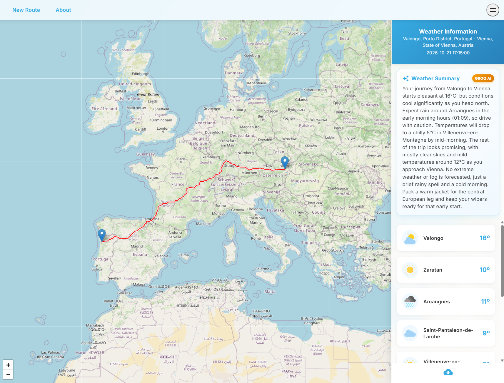
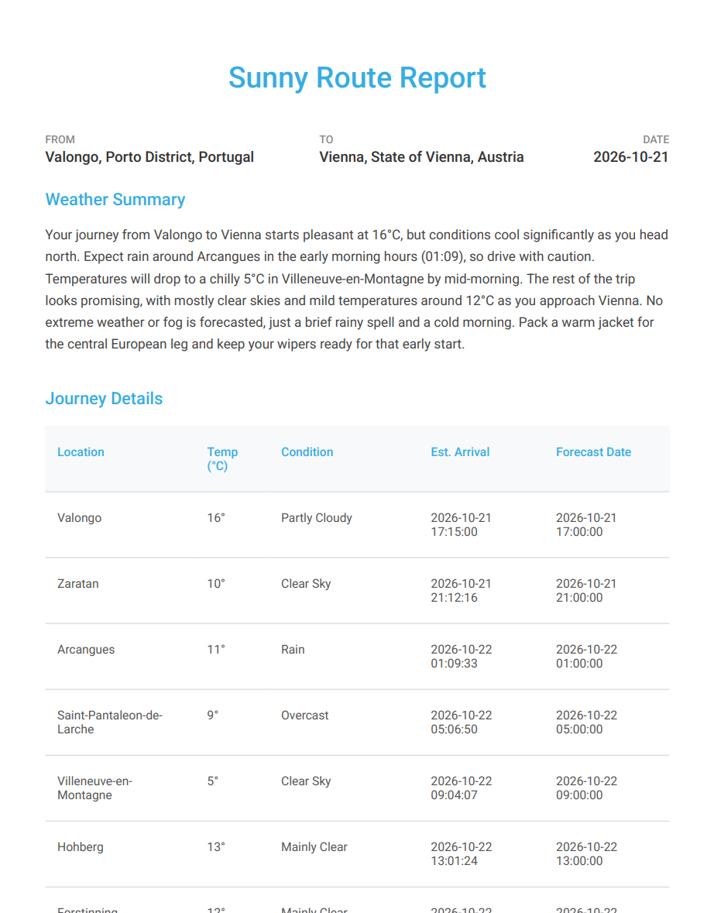

# Sunny Route

**Sunny Route is a smart travel companion that helps you plan road trips by showing weather forecasts along your route in real time.**

Built with Angular 18, Leaflet, and Open-Meteo. It is completely **local-first and open-source**: you can clone it and run it immediately with **zero required API keys or accounts**.

---

## 🚀 Quickstart (Run Locally)

### Prerequisites

- [Node.js](https://nodejs.org/) (v18.19+ or v20+)
- [npm](https://www.npmjs.com/) (v9+)

### Installation & Run

```bash
# 1. Clone the repository
git clone https://github.com/ruijramos/Sunny-Route.git
cd Sunny-Route

# 2. Install dependencies
npm install

# 3. Start the application
npm start
```

Now open **[http://localhost:4200](http://localhost:4200)** in your browser!

---

## ✨ Features

- **Instant Route Planning:** Interactive routing powered by the Open Source Routing Machine (OSRM) and Leaflet.
- **Keyless Weather Forecasts:** Accurate hourly weather forecasts along your route powered by [Open-Meteo](https://open-meteo.com/) (WMO standard, zero keys needed).
- **Fast Typeahead Geocoding:** Instant location autocomplete powered by Open-Meteo Geocoding API & OpenStreetMap.
- **Dynamic Road Checkpoints:** Scalable sampling targeting up to 16 checkpoints with live reverse geocoded city names along the highway.
- **Smart Trip Summary:** Automatic, friendly weather summary for your journey. (Optionally enhanced with Groq AI if you provide an API key).
- **Journey Visualization:** Glassmorphism UI with interactive map and mobile-friendly draggable bottom sheet.
- **Exportable PDF Reports:** One-click downloadable PDF itinerary with detailed weather forecasts for each waypoint.

---

## 📸 Preview & Walkthrough

1. **Plan Your Journey:** Enter your origin, destination, and departure time with fast typeahead autocomplete:

   

2. **Interactive Route & Forecast:** Explore your route on an interactive map with key weather checkpoints and an AI-generated summary:

   

3. **Export PDF Reports:** Download an itinerary report containing forecasts for all route waypoints:

   

---

## ⚙️ Optional Configuration

Sunny Route is designed to be **100% functional out of the box with zero configuration**.

If you wish to enable AI-powered trip summaries with Groq:

1. Copy `.env.example` to `.env`:
   ```bash
   cp .env.example .env
   ```
2. Open `.env` and set your [Groq](https://console.groq.com) API key:
   ```env
   GROQ_API_KEY=gsk_your_key_here
   ```
3. Run `npm start` (the built-in prestart sync script automatically links `.env` to your local build).

---

## 🛠️ Open Services & APIs

Sunny Route prioritizes free, open-source, and privacy-respecting tools:

1. **[Open-Meteo](https://open-meteo.com/):** High-resolution weather forecasts using national weather service models (DWD, NOAA, ECMWF) with no API keys.
2. **[OSRM (Open Source Routing Machine)](https://project-osrm.org/):** High-performance road routing engine.
3. **[Open-Meteo Geocoding API](https://open-meteo.com/en/docs/geocoding-api):** Real-time, fast geocoding autocomplete based on OpenStreetMap data.
4. **[OpenStreetMap Nominatim](https://nominatim.openstreetmap.org/):** Live reverse geocoding for route checkpoint towns with respectful rate pacing.
5. **[Leaflet](https://leafletjs.com/):** Lightweight, open-source mapping library.
6. **[Groq](https://groq.com/) (Optional):** Ultra-fast AI inference for trip summaries.

---

## 💻 Tech Stack

- **Framework:** Angular 18 (Standalone Components, Signals-ready)
- **Language:** TypeScript
- **Styling:** CSS3 Glassmorphism, Angular Material
- **Mapping:** Leaflet & Leaflet Routing Machine
- **PDF Export:** PDFMake

---

## 📄 License

This project is licensed under the MIT License - see the [LICENSE](LICENSE) file for details.
